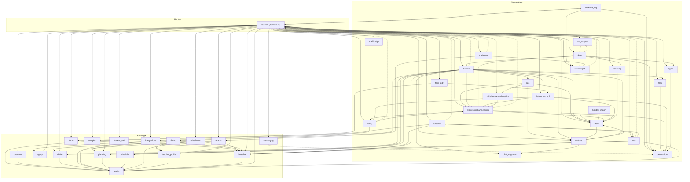
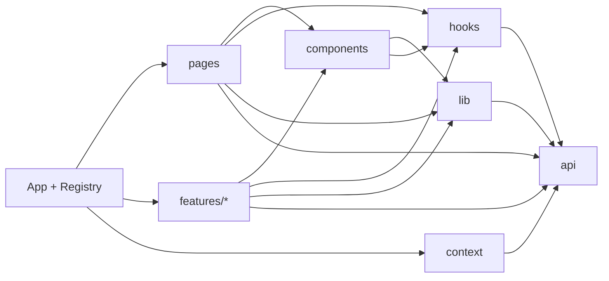

# Abhängigkeiten

> Einstieg: [[Schulmanager Architektur]] · Stand der Analyse: Arbeitsstand 2026-10-12, Importe per AST ausgewertet (inkl. Importe innerhalb von Funktionen)

## Python-Pakete (`pyproject.toml`)

| Paket | Version | Zweck | Genutzt in |
|---|---|---|---|
| `fastapi` | >=0.110 | Web-Framework (Router, Dependencies, SSE/Streaming), bringt Starlette und Pydantic mit | alle `routes/`, [[Server app]], [[Server deps]], [[Lizenzserver]] |
| `uvicorn[standard]` | >=0.29 | ASGI-Server (ein Worker), Start per `uvicorn schulmanager.server.app:app` | Dockerfile, `server/cli.py`, [[Lizenzserver]] |
| `sqlalchemy` | >=2.0 | ORM und Engine (SQLite/PostgreSQL), typisierte `Mapped`-Spalten | [[Server db]], alle Tabellen, [[Lizenzserver]] |
| `alembic` | >=1.13 | Schema-Migrationen | [[Migrationen]], [[Server db]] (`migrate`) |
| `python-multipart` | >=0.0.9 | Multipart-Formulare / Datei-Upload | [[Server files]], [[Routen files]] |
| `psycopg[binary]` | >=3.1 | PostgreSQL-Treiber (psycopg 3) | [[Server db]] |
| `cryptography` | >=42 | AES-256-GCM (Umschlagverschlüsselung), Ed25519 (Lizenzen) | [[Server crypto]], [[Server licensing]], [[Lizenzserver]] |
| `segno` | >=1.5 | QR-Codes (Zugangsbriefe, 2FA) | [[Server letters und pdf]] |

Entwicklung (`[dev]`): `pytest` >=8 – Testläufer (52 Dateien, ~616 Testfunktionen); `httpx` >=0.27 – Test-Client für Starlette `TestClient`; `ruff` >=0.5 – Lint (Regeln E4, E7, E9, F; Zeilenlänge 120).

Im Code zusätzlich direkt importiert, aber **nicht** in `pyproject.toml` deklariert: `pydantic`, `starlette` (kommen transitiv über FastAPI), `anyio` (Threadpool-Größe in [[Server runtime]]). Der [[Lizenzserver]] installiert im eigenen Dockerfile `fastapi uvicorn sqlalchemy cryptography pydantic` ohne Versionen. Ansonsten nutzt der Server bewusst nur die Standardbibliothek (eigener PDF-Schreiber, SMS per `urllib`, Prometheus-Text, IMAP/SMTP).

## npm-Pakete (`frontend/package.json`)

| Paket | Version | Zweck | Genutzt in |
|---|---|---|---|
| `react / react-dom` | ^19.1 | UI-Bibliothek | gesamte Oberfläche |
| `react-router-dom` | ^7.6 | Routing, Guards, `lazy()`-Seiten | [[Frontend App und Routing]] |
| `tweetnacl` | 1.0.3 | Kryptografie im Browser für Ende-zu-Ende-Chats (Gerätschlüssel, NaCl-Boxen) | [[Feature chats]] (`crypto.ts`) |
| `qrcode-generator` | ^2.0.4 | QR-Code für die 2FA-Einrichtung | [[Frontend Komponenten]] (`QrCode.tsx`), [[Seite ProfilePage]] |

Entwicklung: `typescript` ~5.9.3 – strikte Typprüfung (`npm run lint`); `vite` ^7.1 – Dev-Server mit Proxy `/api` → :8000, Produktions-Build; `@vitejs/plugin-react` ^5.0 – React-Plugin für Vite; `vitest` ^4.1.11 – Tests in der Node-Umgebung (31 Testdateien); `@types/*`  – Typdefinitionen für React/Node.

Schmaler Abhängigkeitsbaum mit Absicht: keine UI-Bibliothek, kein State-Manager, kein Query-Framework – die Datenschicht sind `useApi`/`useCollection` ([[Frontend Basis]]).

## Modul-Abhängigkeitsgraph (reduziert)

Pfeil A → B = A importiert B. **Weggelassen** (fast alle importieren sie): `models`, `calendar_utils`, `config`, `db`, `audit`, `events`, `crypto`. „Routen“ fasst alle 46 Routen-Dateien zusammen. Gestrichelt = nur zur Laufzeit in Funktionen importiert (Rückwärtskante gegen die Schichtung).

Die vollständigen Listen („Hängt ab von“ / „Wird genutzt von“) stehen in jeder Backend-Notiz, Zusammenfassung: [[Backend Übersicht]].

## Frontend: Abhängigkeiten zwischen Ordnern

Meistgenutzte Frontend-Einheiten (eingehende Importe aus anderen Einheiten): [[Frontend Basis]] (43), [[Frontend API-Schicht]] (42), [[Frontend Komponenten]] (41).

## Auffälligkeiten

### Sehr große Dateien

| Zeilen | Datei | Notiz |
|---|---|---|
| 3458 | `schulmanager/server/routes/features_channels.py` | [[Routen features_channels]] |
| 1993 | `schulmanager/server/routes/features_messages.py` | [[Routen features_messages]] |
| 1779 | `schulmanager/substitution.py` | [[Modul substitution]] |
| 1584 | `schulmanager/server/files.py` | [[Server files]] |
| 1363 | `schulmanager/integrations/untis_gpu.py` | [[Modul integrations]] |
| 1353 | `schulmanager/server/routes/features_forms.py` | [[Routen features_forms]] |
| 1320 | `schulmanager/server/routes/features_chats.py` | [[Routen features_chats]] |
| 1174 | `schulmanager/server/routes/features_student_absences.py` | [[Routen features_student_absences]] |
| 1132 | `schulmanager/integrations/csv_io.py` | [[Modul integrations]] |
| 1130 | `schulmanager/server/routes/features_classes.py` | [[Routen features_classes]] |
| 1086 | `schulmanager/scheduler.py` | [[Modul scheduler]] |
| 1051 | `schulmanager/server/routes/features_data.py` | [[Routen features_data]] |

Frontend: `api/types.ts` (1247), `pages/MasterDataPage.tsx` (846), `features/chats/ChatsPage.tsx` (820), `pages/UsersPage.tsx` (698), `pages/SubstitutionsPage.tsx` (698), `features/chats/DevicesPanel.tsx` (646).

`routes/features_channels.py` (3446 Zeilen, 132 Funktionen) vereint Kursräume, Material, Aufgaben, Pinnwand, Mitglieder, Kalender-Hilfen (`homework_due`) und Unterricht-Protokoll – naheliegender Kandidat für eine Aufteilung in ein Paket.

### Zyklen

- **Auf Modulebene gibt es keinen Importzyklus** (nur Importe beim Laden gerechnet).
- Rechnet man Importe innerhalb von Funktionen mit, entsteht eine große stark zusammenhängende Gruppe aus 66 Dateien (Server-Kern + Routen: `deps`, `store`, `db`, `crypto`, `files`, `runtime`, `features_common` …). Die Rückwärtskanten sind bewusst als Lazy-Import ausgeführt, um Ladezyklen zu vermeiden – sie zeigen aber echte Kopplung.
- Kleine Zyklen (beide nur über Lazy-Imports): [[Modul models]] ↔ [[Modul calendar_utils]] ↔ [[Modul legacy]] und [[Server autoplan]] ↔ [[Server jobs]].

### Schichtbrüche

- Fachlogik → Server: [[Modul messaging]] importiert `server.permissions` (Rollen-/Rechtekonstanten).
- Server-Kern → Routen (alle lazy): [[Server notify]], [[Server autoplan]], [[Server jobs]] und [[Server elternzugriff]] nutzen `routes/features_common` (`day_plan`, `snapshot`); [[Server betrieb]] (`maintenance`) greift in `features_student_self` und `features_contact`; [[Server konten und anmeldung]] (`sso_providers`) in `oidc`. Hilfen wie `snapshot`/`day_plan` gehören eigentlich in den Server-Kern.
- Routen → Routen: z. B. [[Routen features_student_absences]] ↔ [[Routen features_student_self]], [[Routen features_calendar]] → sieben andere Fach-Router, [[Routen features_contact]] → [[Routen auth]]. [[Routen features_common]] wird von fast allen genutzt und ist damit de facto eine Service-Schicht.
- [[Server permissions]] importiert [[Modul models]] (Klassen-/Kurs-Ermittlung für Scopes) – Rechte und Planungsdokument sind verzahnt.

### Offene Umbauten im Arbeitsstand (hängende Verweise)

Zum Zeitpunkt der Analyse läuft im Arbeitsbaum (uncommittet) der Umbau auf das **52-Wochen-System** ([[Modul weeks]], [[Modul calendar_utils]], [[Modul models]], neu [[Modul legacy]]). `weeks.py` kennt die alten Zyklusfunktionen nicht mehr, mehrere Module und Routen importieren sie aber noch – ein Import-/Attributzugriff auf diese Namen schlägt zur Laufzeit fehl, bis der Umbau abgeschlossen ist. Auch `docs/ARCHITECTURE.md` (Zykluswochen, `week_info.cycle_*`) und das Modul-Docstring von `scheduler.py` beschreiben noch das alte Modell. Per AST ermittelt:

| Modul | Fehlender Name | Verwendet in |
|---|---|---|

*(Momentaufnahme; der Arbeitsbaum ändert sich laufend. Neu seit dem letzten Commit: `legacy.py`, `server/holiday_import.py`, `features/teacher/WorkGrid.tsx`.)*

### Weiteres

- `routes/features_common.mutate` enthält eine Kompatibilitätsprüfung per `inspect.signature`, ob `store.mutate` den Parameter `dates` kennt – Überbleibsel paralleler Entwicklung, heute überflüssig.
- Chat-Tabellen (`chats`, `chat_members`, `chat_messages` …) und mehrere Fach-Tabellen haben keine Fremdschlüssel-Constraints; Konsistenz hängt allein vom Code ab ([[Datenmodell]]).
- Dokumentationsdrift: `docs/code/README.md` nennt „8 Rollen, 29 Rechte“ und Migrationskopf 0013 – der Code hat 12 Rollen, 39 Rechte, Kopf 0022 ([[Rollen und Rechte]], [[Migrationen]]).
- Wenige direkte Abhängigkeiten, aber alles in einem Prozess: Store, SSE-Bus, Job-Verwaltung und Hintergrunddienste sind prozesslokal – horizontale Skalierung ist ausgeschlossen ([[Betrieb und Deploy]]).

<!-- eigene Notizen -->
