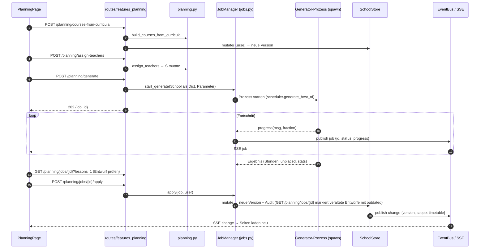
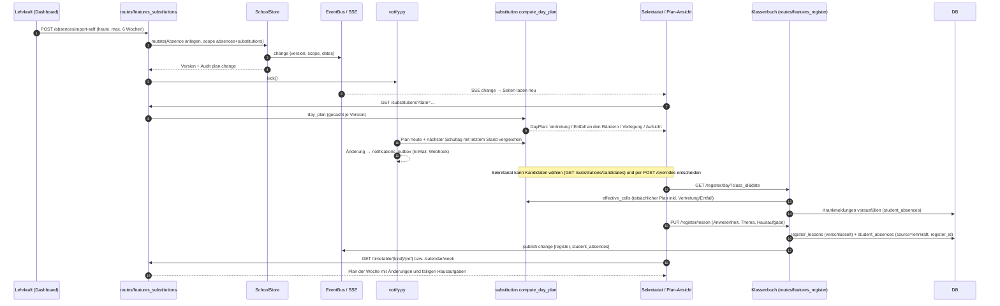
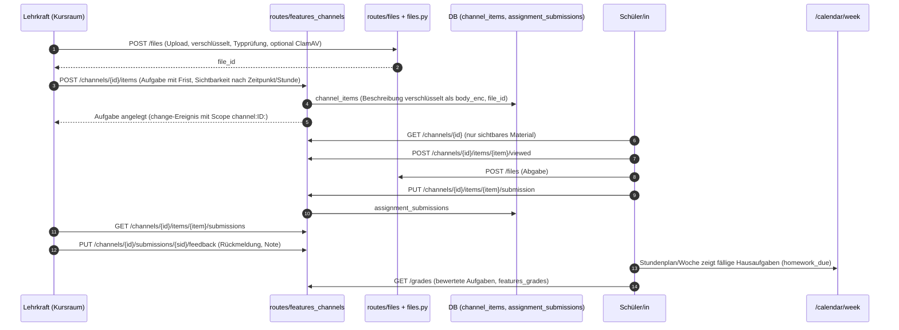
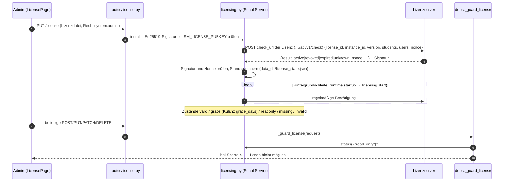
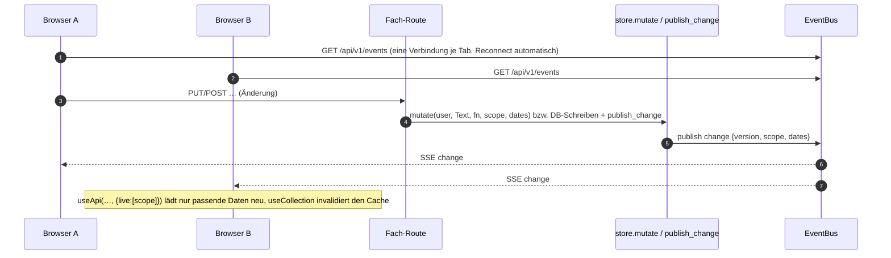

# Abläufe

> Einstieg: [[Schulmanager Architektur]] · Sequenzdiagramme der wichtigsten Abläufe

## 1. Login mit 2FA und Kontowechsel

Beteiligt: [[Seite LoginPage]], [[Frontend API-Schicht]], [[Routen auth]], [[Server deps]], [[Server konten und anmeldung]], [[Server audit]], Tabellen `users`, `sessions`, `login_attempts`.

```mermaid
sequenceDiagram
  autonumber
  participant B as Browser (LoginPage)
  participant A as routes/auth.py
  participant K as login_policy / security
  participant DB as DB (users, sessions)
  B->>A: POST /auth/login {username, password}
  A->>DB: Sperre prüfen (login_attempts, 429 bei zu vielen Fehlversuchen)
  A->>DB: Konto laden, Passwort prüfen (scrypt)
  alt 2FA aktiv und kein Code
    A-->>B: 401 totp_required
    B->>A: POST /auth/login {…, totp}
    A->>K: TOTP prüfen (mit Replay-Schutz)
  end
  A->>K: password_login(user) – Anmelde-Richtlinie (erlaubt / setup / verweigert)
  K-->>A: erlaubt
  A->>DB: Sitzung anlegen (Token nur als Hash), Audit auth.login
  A-->>B: Set-Cookie sm_session (httponly) + {user, csrf_token}
  Note over B,A: Folgeanfragen: Cookie + Header X-CSRF-Token bei POST/PUT/PATCH/DELETE
  B->>A: POST /auth/login?add=true (weiteres Konto)
  A-->>B: neues Cookie sm_session; bisherige Tokens im Cookie sm_sessions (max. 5 Konten)
  B->>A: POST /auth/accounts/switch {user_id}
  A-->>B: Cookie wechselt, neues csrf_token
```

Pflichtseiten erzwingt der Guard: `/passwort` (Startpasswort), `/zwei-faktor` (Rolle laut `SM_REQUIRE_2FA_ROLES`), `/konten-verbinden` (Pflicht-Verknüpfung laut Richtlinie). SSO läuft über [[Routen features_sso]] / [[Routen oidc]] und endet in derselben `login_user`-Funktion.

## 2. Stundenplan erzeugen

Beteiligt: [[Seite PlanningPage]], [[Routen features_planning]], [[Modul planning]], [[Server jobs]], [[Modul scheduler]], [[Server events]], [[Server store]].



**Auto-Planer:** Ein `change` mit planungsrelevantem Scope weckt [[Server autoplan]]; nach `SM_AUTOPLAN_DELAY` s Ruhe prüft [[Modul autoplan]] den Plan, repariert direkt oder startet einen Job der Art `autoplan` (nur betroffene Kurse frei, Rest samt Räumen fixiert) und übernimmt das Ergebnis selbstständig, wenn es besser ist (Scope `autoplan`, rückgängig über [[Seite HistoryPage]]). Neuplanung einer Lehrkraft: `POST /planning/replan-teacher/{id}` → Entwurf.

## 3. Krankmeldung → Vertretung → Klassenbuch → Stundenplan

Beteiligt: [[Seite DashboardPage]], [[Seite SubstitutionsPage]], [[Routen features_substitutions]], [[Modul substitution]], [[Server notify]], [[Routen features_register]], [[Feature classes]], [[Routen features_student_absences]], [[Routen features_timetable]], [[Routen features_calendar]].



Schüler/Eltern können selbst melden (`POST /student-absences`); Minderjährige nie selbst, Volljährige und Eltern nach den Regeln aus [[Server elternzugriff]]. Das Klassenbuch legt Fehlen/Verspätung als offene Fehlzeit an, entschuldigt wird erst durch Eltern/Volljährige plus Bestätigung.

## 4. Kursraum: Material und Hausaufgabe

Beteiligt: [[Feature channels]], [[Routen features_channels]], [[Modul channels]], [[Routen files]], [[Server files]], [[Routen features_calendar]], [[Routen features_grades]].



Eltern sehen Kursräume ihrer Kinder nur nach `parent_access` (A-44/A-46); Schulbegleitung wie das begleitete Kind. Live-Updates nutzen Scopes mit Doppelpunkt am Ende (`channel:5:`), weil Scopes per Präfix in beide Richtungen verglichen werden.

## 5. Lizenzprüfung

Beteiligt: [[Server licensing]], [[Server deps]], [[Routen license]], [[Seite LicensePage]], [[Lizenzserver]], [[Server runtime]].



Konten-Obergrenze: `licensing.user_limit` (nur mit `SM_LICENSE_ENFORCE`). Die Sauber-Instanz läuft mit Durchsetzung, siehe [[Betrieb und Deploy]].

## 6. Live-Update über SSE



Details: [[Server events]], [[Frontend Basis]] (`useLive`, `useApi`), [[Frontend API-Schicht]] (`events.ts`).

<!-- eigene Notizen -->
