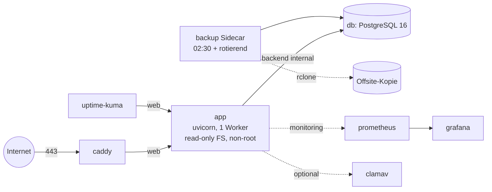
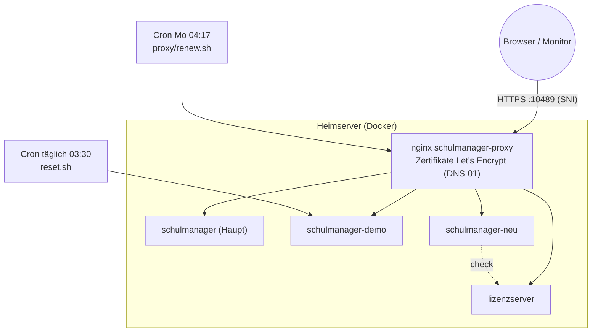

# Betrieb und Deploy

> Einstieg: [[Schulmanager Architektur]] · Konfiguration im Code: [[Server config]] · Start: [[Server runtime]]

*Diese Notiz enthält bewusst keine Passwörter, Tokens oder Schlüssel – die stehen ausschließlich in den `.env`-Dateien bzw. Datenvolumina auf dem Server.*

## Bausteine im Repo

| Datei | Rolle |
|---|---|
| `Dockerfile` | Mehrstufig: `frontend` (Node 22, `npm run build`), `pydeps` (venv aus `pyproject.toml`), `dev`, `runtime` (Python 3.12-slim, non-root, Healthcheck). Standard-Target ist `runtime`. |
| `docker-compose.yml` | Produktion: `app` (+ `db` PostgreSQL 16, `caddy`, `backup`); Profile `monitoring` (Prometheus, Grafana), `uptime` (Uptime-Kuma), `antivirus` (ClamAV). |
| `docker-compose.sqlite.yml` | Schlanke Variante ohne PostgreSQL für Tests, Demos, Schulungen (erweitert `app` aus der Haupt-Compose). |
| `docker-compose.dev.yml` | Entwicklung: uvicorn `--reload` (:8000) + Vite (:5173), optional Postgres/Mailpit. |
| `deploy/Caddyfile`, `deploy/caddy/` | Caddy als Reverse Proxy mit automatischem HTTPS (Let's Encrypt). |
| `deploy/nginx/schulmanager.conf` | nginx-Alternative (Rate-Limit Login 10/min, iCal-Token im Log maskiert). |
| `deploy/systemd/` | Betrieb ohne Docker: `schulmanager.service`, `schulmanager-backup.service/.timer` (täglich 02:30). |
| `deploy/backup/` | Backup-Sidecar: `backup-loop.sh` (Zeiten `BACKUP_TIMES`, Healthcheck auf Alter). |
| `deploy/prometheus`, `deploy/grafana` | Metriken (`/metrics`, [[Server middleware und metrics]]) und Dashboards/Alarme. |
| `deploy/docker/entrypoint.sh` | `serve` (Migrationen, dann uvicorn), `migrate`, `create-admin`, `cli`, `shell`. |
| `scripts/` | `backup.sh` / `restore.sh` (Rotation daily/weekly/monthly/manual, optional GPG und Offsite), `create-admin.sh`, `healthcheck.sh`, `migrate.sh`, `dev.sh`, `preview.sh`. |
| `.github/workflows/` | `ci.yml` (Backend SQLite + PostgreSQL, Frontend, Infra-Lint, Docker), `codeql.yml`, `release.yml` (Tags `v*.*.*` → GHCR-Images, App + Backup). |
| `Makefile` | `make dev`, `test`, `lint`, `build`, `demo`. |

## Container-Topologie (Produktions-Compose)

Netze: `web` (Caddy ↔ App, Ausgang ins Internet für SMTP/Webhooks/ACME), `backend` (**internal**, DB nie veröffentlicht), `egress` (nur Backup/ClamAV), `monitoring`. Volumes: `app_data` (Dateiablage, Sicherungen), `pgdata`, `caddy_data`, `prometheus_data`, `grafana_data`.

**Genau ein App-Worker** (`SM_WORKERS=1`): Planungsdokument ([[Server store]]) und SSE-Bus ([[Server events]]) leben im Prozessspeicher; Generator-Jobs laufen als `spawn`-Kindprozess ([[Server jobs]]).

## Instanzen auf dem Heimserver (Test- und Vorführbetrieb)

Der Heimserver (Debian) betreibt mehrere unabhängige Compose-Projekte, alle hinter **einem** nginx-Container `schulmanager-proxy` (TLS, Auswahl per SNI). Von außen ist nur Port 10489 geöffnet; die Adressen brauchen deshalb `:10489`.

| Instanz | Verzeichnis / Container | Adresse | Besonderheit |
|---|---|---|---|
| Haupt (Test) | `~/schulmanager/`, Container `schulmanager` | https://schulmanager.l0rdr3spawn.duckdns.org:10489 | Entwicklungsstand mit Demo-Konten; Rolle `zuschauer` (nur lesen) als Vorführzugang |
| Demo (öffentlich) | `~/schulmanager-demo/`, Container `schulmanager-demo` | https://schulmanager-demo.l0rdr3spawn.duckdns.org:10489 | `SM_DEMO_PUBLIC=1` (Rollen-Schaltflächen im Login, `_guard_demo`), **täglicher Reset 03:30** per Cron (`reset.sh`: `down -v`, `up`, Beispieldaten über die API einspielen) |
| Sauber („neu“) | `~/schulmanager-neu/` | https://schulmanager-neu.l0rdr3spawn.duckdns.org:10489 | leere Schule mit nur einem Inhaber-Admin, `SM_LICENSE_ENFORCE=1` |
| Lizenzserver | `~/lizenzserver/`, Image `lizenzserver` | https://lizenz.l0rdr3spawn.duckdns.org:10489/api/v1/check | privater Signaturschlüssel nur im Datenvolumen des Servers; Lizenzen per CLI im Container ausstellen |

- **Zertifikate:** Let's Encrypt per DNS-01 (acme.sh, DuckDNS); `proxy/renew.sh` läuft montags 04:17 per Cron und installiert die Zertifikate aller Hosts.
- **Router:** der externe Port wird über die Portfreigaben-Liste des Heimservers gepflegt; mehr als ein Port ist nicht nötig, weil SNI die Instanzen trennt.
- **Deploy-Rezept:** Arbeitsstand als Archiv auf den Server, `src/` austauschen, `docker compose up -d --build`. Hat der Server keinen Internetzugang (Build scheitert), wird `src/schulmanager` samt lokal gebautem `frontend/dist` per `docker cp` in den Container kopiert und mit `docker commit` als Image gesichert. Vorher ein Rollback-Image taggen. Archive nie unter restriktiver `umask` entpacken (Dateien unlesbar → Crash-Loop).
- **Migrationen:** laufen beim Start automatisch ([[Migrationen]]); bei abweichender Nummerierung der Datenbank vorher Revision abbilden oder frische Datenbank nutzen.
- **Demo-Schutz:** nach jedem Reset sind die eingebauten Demo-Konten gesperrt; Zugänge der Inhaber-Rolle werden separat ausgegeben ([[Routen users]] `/demo-access`).

## Backups und Wartung

- **Backup-Sidecar** (Compose) bzw. **systemd-Timer** (ohne Docker): täglich 02:30 (+ bis zu 10 min Zufallsversatz), Rotation `BACKUP_KEEP_DAILY/WEEKLY/MONTHLY/MANUAL`, optional GPG-Verschlüsselung und Offsite-Kopie; `--label vor-update` legt eine manuelle Sicherung an. PostgreSQL per `pg_dump`, SQLite per Online-Backup-API.
- **Im Server selbst:** [[Server betrieb]] `backups` (JSON-Export/SQLite-Kopie, bedienbar über [[Routen admin]] und [[Seite AdminPage]]) und `maintenance` (Stundenschleife `SM_MAINTENANCE_INTERVAL`: abgelaufene Sitzungen/Tokens, Login-Versuche, optional Auto-Backup `SM_AUTO_BACKUP_HOURS`).
- **Restore:** `scripts/restore.sh` (mit `--stop-cmd/--start-cmd`), monatlicher Test-Restore in eine Wegwerf-Datenbank ist Pflicht laut Betriebshandbuch. Verschlüsselungsschlüssel (`SM_ENCRYPTION_KEYS`) **getrennt vom Backup** aufbewahren – ohne sie sind Nachrichten, Dateien und Atteste unlesbar ([[Server crypto]]).
- **Lizenzserver-Backup:** privater Schlüssel offline sichern; geht er verloren, können keine Lizenzen mehr ausgestellt werden ([[Lizenzserver]]).

## Wichtige Variablen (nur Namen)

`SM_ENV`, `SM_DATABASE_URL`, `SM_SECRET_KEY`, `SM_ENCRYPTION_KEYS`, `SM_BASE_URL`, `SM_COOKIE_SECURE`, `SM_TRUST_PROXY`, `SM_WORKERS` (=1), `SM_ADMIN_USER`/`SM_ADMIN_PASSWORD` (Erst-Admin), `SM_LOAD_DEMO`, `SM_DEMO_PUBLIC`, `SM_AUTO_MIGRATE`, `SM_GENERATE_TIME_LIMIT`, `SM_AUTOPLAN*`, `SM_MAIL_SYNC*`, `SM_SMTP_*`, `SM_OIDC_*`, `SM_LICENSE_ENFORCE`, `SM_LICENSE_PUBKEY`, `SM_LICENSE_FILE`, `SM_REQUIRE_2FA_ROLES`, `SM_UPLOAD_MAX_MB`, `SM_CLAMAV_HOST`, `SM_METRICS_TOKEN`; Lizenzserver: `LZ_DATA_DIR`. Vollständige Liste: `.env.example` und `docs/BETRIEB.md` §13; Auswertung im Code: [[Server config]].

## Siehe auch

[[Abläufe]] (Lizenzprüfung) · [[Server licensing]] · [[Lizenzserver]] · [[Abhängigkeiten]] · [[Backend Übersicht]]

<!-- eigene Notizen -->
