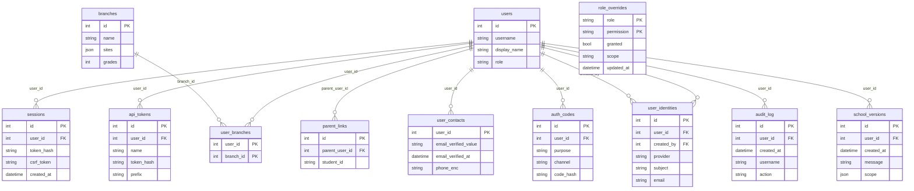
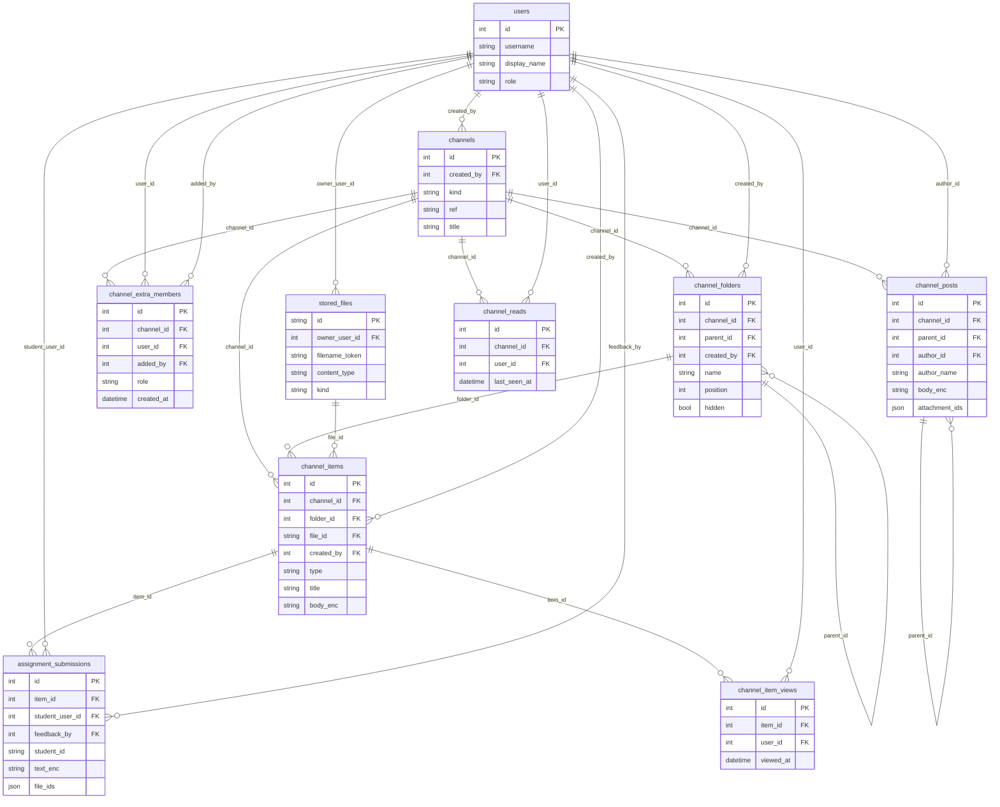
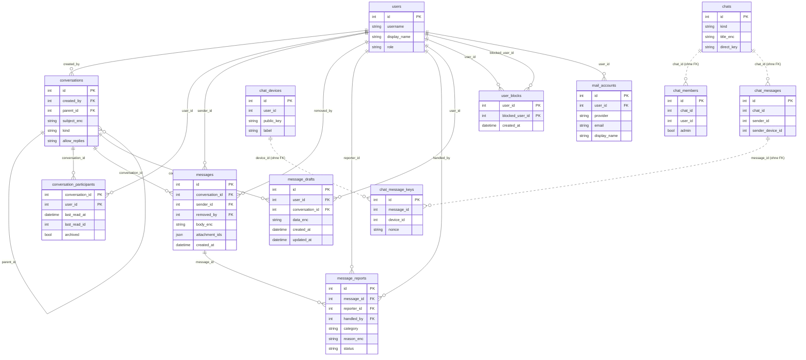
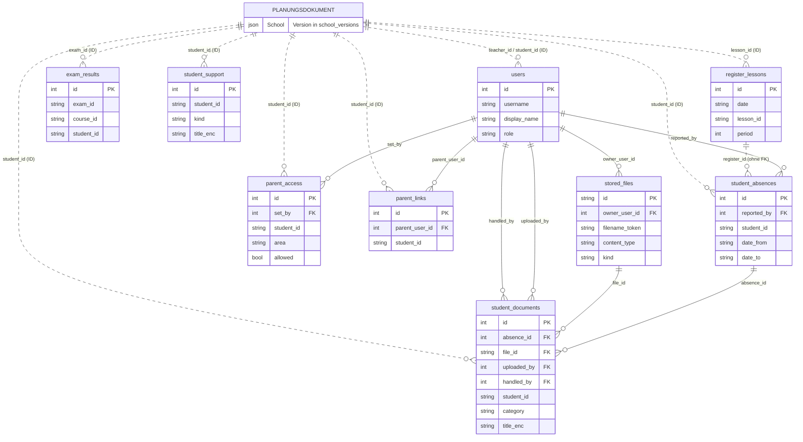

# Datenmodell

> Einstieg: [[Schulmanager Architektur]] · ORM: [[Server db]] · Schemaänderungen: [[Migrationen]]

## Zwei Arten von Daten

1. **Planungsdokument** – Stammdaten, Stundentafeln, Kurse, Stunden, Abwesenheiten, Overrides, Ferien, Aufsichten, Klausuren und Einstellungen bilden **ein** `School`-Objekt ([[Modul models]]). Es liegt nicht in Einzeltabellen, sondern als zlib-komprimiertes JSON versioniert in `school_versions` und wird vom [[Server store]] im Speicher gehalten. Jede Änderung = neue Version (Verlauf, Undo, Audit).
2. **Relationale Tabellen** (SQLAlchemy) – alles mit Konto- oder Personenbezug: Konten, Sitzungen, Nachrichten, Dateien, Krankmeldungen, Noten …

Verbindung zwischen beiden **nur über IDs** (`users.teacher_id`, `users.student_id`, `parent_links.student_id`, `student_absences.student_id` …) – es gibt keine Fremdschlüssel in das Dokument. Personenbezogene Freitexte sind verschlüsselt (`*_enc`, [[Server crypto]]), Codes und Tokens nur als Hash.

### Sammlungen des Planungsdokuments (`COLLECTIONS`)

| Sammlung | Klasse |
|---|---|
| `sites` | `Site` |
| `subjects` | `Subject` |
| `teachers` | `Teacher` |
| `rooms` | `Room` |
| `classes` | `SchoolClass` |
| `students` | `Student` |
| `curricula` | `Curriculum` |
| `courses` | `Course` |
| `lessons` | `Lesson` |
| `absences` | `Absence` |
| `overrides` | `Override` |
| `holidays` | `Holiday` |
| `areas` | `SupervisionArea` |
| `duties` | `Duty` |
| `exams` | `Exam` |
| `events` | `Event` |

Zusätzlich im Dokument: `settings` (`Settings`), `lessons`, `absences`, `overrides`, `holidays`, `duties`, `exams`. Definition: `schulmanager/models.py`.

## Tabellen nach Bereich (63 Schultabellen + 2 im Lizenzserver)

### Konten und Anmeldung

| Tabelle | ORM-Klasse | Definition | Bedeutung | Genutzt von |
|---|---|---|---|---|
| `users` | `User` | `schulmanager/server/db_models.py:21` | Relationale Tabellen (SQLAlchemy 2, typisierte `Mapped`-Spalten). (laut Moduldoku) | [[Routen admin]], [[Routen auth]], [[Routen features_api_access]], [[Routen features_channels]], [[Routen features_contact]] +25 |
| `sessions` | `UserSession` | `schulmanager/server/db_models.py:46` | Anmeldesitzung (Cookie `sm_session`). Gespeichert wird nur der Hash des Tokens. | [[Routen admin]], [[Routen auth]], [[Routen features_sso]], [[Routen me]], [[Routen users]] +4 |
| `api_tokens` | `ApiToken` | `schulmanager/server/db_models.py:61` | API-Token (`Authorization: Bearer`), nur als Hash gespeichert. | [[Routen features_api_access]], [[Routen me]], [[Routen users]], [[Server api_scopes]], [[Server betrieb]] +2 |
| `login_attempts` | `LoginAttempt` | `schulmanager/server/db_models.py:83` | Relationale Tabellen (SQLAlchemy 2, typisierte `Mapped`-Spalten). (laut Moduldoku) | [[Routen auth]], [[Routen features_contact]], [[Routen me]], [[Server betrieb]], [[Server konten und anmeldung]] |
| `parent_links` | `ParentLink` | `schulmanager/server/db_models.py:93` | Eltern-Konto ↔ Kind (`Student.id` im Planungsdokument). | [[Routen features_channels]], [[Routen features_forms]], [[Routen features_login_policy]], [[Routen features_messages]], [[Routen features_parent_access]] +6 |
| `user_contacts` | `UserContact` | `schulmanager/server/feature_models/contact.py:34` | Kontakt & Wiederherstellung (Erweiterung 4, §11.2): bestätigte E-Mail/Handynummer und Einmal-Codes. (laut Mod… | [[Routen features_contact]], [[Server betrieb]] |
| `auth_codes` | `AuthCode` | `schulmanager/server/feature_models/contact.py:46` | Kontakt & Wiederherstellung (Erweiterung 4, §11.2): bestätigte E-Mail/Handynummer und Einmal-Codes. (laut Mod… | [[Routen features_contact]], [[Routen features_letters]] |
| `user_identities` | `UserIdentity` | `schulmanager/server/feature_models/identities.py:23` | Verbundene Anbieter-Konten und Anbieter-Einrichtung (Erweiterung 4, docs/ARCHITECTURE.md §11.4). (laut Moduld… | [[Routen features_sso]], [[Server konten und anmeldung]] |
| `sso_providers` | `SsoProvider` | `schulmanager/server/feature_models/identities.py:41` | Verbundene Anbieter-Konten und Anbieter-Einrichtung (Erweiterung 4, docs/ARCHITECTURE.md §11.4). (laut Moduld… | [[Routen features_sso]], [[Server konten und anmeldung]] |
| `login_policy_rules` | `LoginPolicyRule` | `schulmanager/server/feature_models/login_policy.py:35` | Anmelde-Richtlinien (Erweiterung 4, §11.5): wer darf sich wie anmelden (Tabelle `login_policy_rules`). (laut… | [[Routen features_login_policy]], [[Server konten und anmeldung]] |
| `letter_batches` | `LetterBatch` | `schulmanager/server/feature_models/letters.py:22` | Zugangsbriefe (§11.3): kurzlebige Stapel mit Startpasswörtern (Tabelle `letter_batches`). (laut Moduldoku) | [[Server letters und pdf]] |
| `account_initial_passwords` | `AccountInitialPassword` | `schulmanager/server/feature_models/letters.py:35` | Zuletzt erzeugtes Startpasswort eines Kontos – **verschlüsselt** (AAD `account_initial_passwords:<user_id>`), | [[Routen features_letters]], [[Server letters und pdf]] |

### Rollen und Rechte

| Tabelle | ORM-Klasse | Definition | Bedeutung | Genutzt von |
|---|---|---|---|---|
| `role_overrides` | `RoleOverride` | `schulmanager/server/db_models.py:103` | Schulspezifische Abweichung vom Standard der Rollenrechte (`permissions.effective_rights`). | [[Server rights]] |
| `branches` | `Branch` | `schulmanager/server/db_models.py:118` | Schulzweig/Abteilung: Klassen über Standort, Klassenstufe oder einzelne Klassen (Abteilungsleitung). | [[Routen rights]], [[Server rights]] |
| `user_branches` | `UserBranch` | `schulmanager/server/db_models.py:129` | Zuordnung Konto (Abteilungsleitung) ↔ Zweig. | [[Routen rights]], [[Server rights]] |
| `parent_access` | `ParentAccess` | `schulmanager/server/feature_models/parent_access.py:19` | Einstellung einer/eines volljährigen Schüler/in: Eltern dürfen einen Bereich sehen (ja/nein). | [[Server elternzugriff]] |

### Planungsdokument und Protokoll

| Tabelle | ORM-Klasse | Definition | Bedeutung | Genutzt von |
|---|---|---|---|---|
| `school_versions` | `SchoolVersion` | `schulmanager/server/db_models.py:151` | Version des Planungsdokuments (`School` als zlib-komprimiertes JSON). | [[Routen admin]], [[Server app]], [[Server konten und anmeldung]], [[Server store]] |
| `audit_log` | `AuditLog` | `schulmanager/server/db_models.py:137` | Relationale Tabellen (SQLAlchemy 2, typisierte `Mapped`-Spalten). (laut Moduldoku) | [[Routen history]], [[Routen me]], [[Server audit]], [[Server konten und anmeldung]] |
| `notifications_outbox` | `NotificationOutbox` | `schulmanager/server/db_models.py:214` | Ausgehende Benachrichtigungen (Webhook/E-Mail) mit Retry (Backend-Features). | [[Routen features_messages]], [[Server konten und anmeldung]] |
| `announcements` | `Announcement` | `schulmanager/server/db_models.py:164` | Mitteilung (Backend-Features). | [[Routen features_announcements]], [[Routen me]], [[Server konten und anmeldung]] |

### Dateien

| Tabelle | ORM-Klasse | Definition | Bedeutung | Genutzt von |
|---|---|---|---|---|
| `stored_files` | `StoredFile` | `schulmanager/server/feature_models/files.py:19` | Eine hochgeladene Datei (Inhalt verschlüsselt auf der Platte). | [[Routen features_messages]], [[Server files]] |

### Kursräume

| Tabelle | ORM-Klasse | Definition | Bedeutung | Genutzt von |
|---|---|---|---|---|
| `channels` | `Channel` | `schulmanager/server/feature_models/channels.py:76` | Kanal (Kursraum) eines Kursteils, einer Klasse oder frei angelegt. | [[Routen features_channels]], [[Routen features_grades]] |
| `channel_extra_members` | `ChannelExtraMember` | `schulmanager/server/feature_models/channels.py:96` | Zusätzliches Mitglied eines Kanals (nur `channels.manage` ohne Einschränkung legt sie an). | [[Routen features_channels]] |
| `channel_folders` | `ChannelFolder` | `schulmanager/server/feature_models/channels.py:109` | Ordner (verschachtelt über `parent_id`). | [[Routen features_channels]] |
| `channel_items` | `ChannelItem` | `schulmanager/server/feature_models/channels.py:135` | Material (Datei, Link, Textseite) oder Aufgabe. | [[Routen features_channels]], [[Routen features_grades]] |
| `assignment_submissions` | `AssignmentSubmission` | `schulmanager/server/feature_models/channels.py:170` | Abgabe einer Schülerin/eines Schülers zu einer Aufgabe. | [[Routen features_channels]], [[Routen features_grades]] |
| `channel_posts` | `ChannelPost` | `schulmanager/server/feature_models/channels.py:192` | Beitrag auf der Pinnwand (`parent_id` = Antwort auf einen Beitrag). | [[Routen features_channels]] |
| `channel_reads` | `ChannelRead` | `schulmanager/server/feature_models/channels.py:211` | Letzter Besuch eines Kontos in einem Kanal (Hervorhebung „neu“). | [[Routen features_channels]] |
| `channel_item_views` | `ChannelItemView` | `schulmanager/server/feature_models/channels.py:222` | Material, das ein Konto schon geöffnet hat (Bereich „Unterricht“: Hinweis auf noch nicht angesehenes Material… | [[Routen features_channels]] |

### Postfach und Chats

| Tabelle | ORM-Klasse | Definition | Bedeutung | Genutzt von |
|---|---|---|---|---|
| `conversations` | `Conversation` | `schulmanager/server/feature_models/messages.py:39` | Unterhaltung: `direct` (zwei Personen), `group` (mehrere Einzelpersonen), `broadcast` (Rundschreiben an | [[Routen features_mail]], [[Routen features_messages]], [[Server chat_migration]] |
| `conversation_participants` | `ConversationParticipant` | `schulmanager/server/feature_models/messages.py:76` | Teilnahme eines Kontos an einer Unterhaltung (Lesestand, Archiv, Stummschalten, „für mich gelöscht“). | [[Routen features_mail]], [[Routen features_messages]], [[Server chat_migration]] |
| `messages` | `Message` | `schulmanager/server/feature_models/messages.py:100` | Nachricht. `body_enc` verschlüsselt; `removed_at` = von der Moderation ausgeblendet (Inhalt bleibt als | [[Routen features_mail]], [[Routen features_messages]], [[Server chat_migration]], [[Server middleware und metrics]] |
| `message_reports` | `MessageReport` | `schulmanager/server/feature_models/messages.py:130` | Meldung einer Nachricht an die Moderation (`messages.moderate`). Begründung und Vermerk verschlüsselt. | [[Routen features_messages]] |
| `user_blocks` | `UserBlock` | `schulmanager/server/feature_models/messages.py:148` | `user_id` nimmt keine Nachrichten von `blocked_user_id` mehr an. | [[Routen features_messages]] |
| `message_user_settings` | `MessageUserSettings` | `schulmanager/server/feature_models/messages.py:158` | Postfach-Einstellungen eines Kontos (E-Mail-Hinweis) und Sperre durch die Moderation. | [[Routen features_messages]] |
| `message_drafts` | `MessageDraft` | `schulmanager/server/feature_models/messages.py:171` | Entwurf (neue Nachricht oder Antwort, `conversation_id`) – Inhalt als verschlüsseltes JSON. | [[Routen features_messages]] |
| `mail_accounts` | `MailAccount` | `schulmanager/server/feature_models/mail.py:21` | Verbundene E-Mail-Konten (Google, Apple/iCloud, Microsoft/Outlook, GMX, Web.de, T-Online, Yahoo, eigener Serv… | [[Routen features_mail]] |
| `chat_devices` | `ChatDevice` | `schulmanager/server/feature_models/chats.py:23` | Ein Browser/Gerät eines Kontos mit seinem öffentlichen Schlüssel (X25519, Base64). | [[Routen features_chats]] |
| `chats` | `Chat` | `schulmanager/server/feature_models/chats.py:68` | Chats (Einzel-, Gruppen- und Klassenchats) mit Ende-zu-Ende-Verschlüsselung. (laut Moduldoku) | [[Routen features_chats]], [[Server chat_migration]] |
| `chat_members` | `ChatMember` | `schulmanager/server/feature_models/chats.py:90` | Chats (Einzel-, Gruppen- und Klassenchats) mit Ende-zu-Ende-Verschlüsselung. (laut Moduldoku) | [[Routen features_chats]], [[Server chat_migration]] |
| `chat_messages` | `ChatMessage` | `schulmanager/server/feature_models/chats.py:109` | Chats (Einzel-, Gruppen- und Klassenchats) mit Ende-zu-Ende-Verschlüsselung. (laut Moduldoku) | [[Routen features_chats]], [[Routen features_messages]], [[Server chat_migration]] |
| `chat_message_keys` | `ChatMessageKey` | `schulmanager/server/feature_models/chats.py:135` | Nachrichtenschlüssel, verpackt für ein Empfängergerät. | [[Routen features_chats]] |
| `chat_reports` | `ChatReport` | `schulmanager/server/feature_models/chats.py:149` | Chats (Einzel-, Gruppen- und Klassenchats) mit Ende-zu-Ende-Verschlüsselung. (laut Moduldoku) | [[Routen features_chats]] |

### Schüler, Klassenbuch und Noten

| Tabelle | ORM-Klasse | Definition | Bedeutung | Genutzt von |
|---|---|---|---|---|
| `student_absences` | `StudentAbsence` | `schulmanager/server/db_models.py:185` | Krankmeldung/Abwesenheit eines Schülers (Backend-Features). | [[Routen features_absence_log]], [[Routen features_absence_stats]], [[Routen features_calendar]], [[Routen features_channels]], [[Routen features_register]] +4 |
| `student_documents` | `StudentDocument` | `schulmanager/server/feature_models/student_self.py:21` | Schüler-Selbstbedienung (Erweiterung 2, §9.6): eingereichte Dokumente/Atteste (Tabelle `student_documents`).… | [[Routen features_student_absences]], [[Routen features_student_self]], [[Server makeups]] |
| `student_support` | `StudentSupport` | `schulmanager/server/feature_models/support.py:18` | Förderinformationen je Schüler/in: Nachteilsausgleich, Schulbegleitung, Förderplan, Sonstiges – mit Dokumente… | [[Routen features_support]] |
| `register_lessons` | `RegisterLesson` | `schulmanager/server/feature_models/register.py:16` | Klassenbuch: eine Zeile je gehaltener Unterrichtsstunde (Datum, Stunde, Kurs/Kursteil) mit Thema, Hausaufgabe… | [[Routen features_channels]], [[Routen features_register]] |
| `exam_results` | `ExamResult` | `schulmanager/server/feature_models/grades.py:13` | Noten zu Klausuren/Tests (`exam_results`). Note und Bemerkung verschlüsselt (AAD `exam_results.<feld>:<id>`).… | [[Routen features_grades]] |

### Lehrkräfte

| Tabelle | ORM-Klasse | Definition | Bedeutung | Genutzt von |
|---|---|---|---|---|
| `teacher_change_requests` | `TeacherChangeRequest` | `schulmanager/server/feature_models/teacher.py:23` | Lehrer-Selbstverwaltung: Änderungsanträge von Lehrkräften (Tabelle `teacher_change_requests`). (laut Moduldok… | [[Routen features_teacher_profile]] |

### Sonstige Tabellen

| Tabelle | ORM-Klasse | Definition | Bedeutung | Genutzt von |
|---|---|---|---|---|
| `api_token_log` | `ApiTokenLog` | `schulmanager/server/feature_models/api_access.py:16` | Nutzungsprotokoll der API-Zugänge (`api_token_log`; docs/API-ZUGAENGE.md). (laut Moduldoku) | [[Routen features_api_access]], [[Server api_scopes]] |
| `chat_attachments` | `ChatAttachment` | `schulmanager/server/feature_models/chats.py:168` | Bild/GIF einer Chat-Nachricht: **im Browser verschlüsseltes** Blob (Schlüssel steht nur in der verschlüsselten | [[Routen features_chats]] |
| `chat_key_backups` | `ChatKeyBackup` | `schulmanager/server/feature_models/chats.py:56` | Optionales Wiederherstellungs-Backup: der private Archivschlüssel des Kontos, im Browser mit einem aus | [[Routen features_chats]] |
| `chat_link_requests` | `ChatLinkRequest` | `schulmanager/server/feature_models/chats.py:40` | Anfrage eines neuen Geräts, den Verlauf von einem eingerichteten Gerät desselben Kontos zu erhalten. | [[Routen features_chats]] |
| `chat_report_images` | `ChatReportImage` | `schulmanager/server/feature_models/chats.py:183` | Bild, das die meldende Person freiwillig für die Moderation mitschickt (Server-seitig verschlüsselt). | [[Routen features_chats]] |
| `exam_makeup_dates` | `ExamMakeupDate` | `schulmanager/server/feature_models/makeups.py:24` | Nachschreibtermine: Wer eine Klausur/einen Test wegen Krankheit oder Fehlens verpasst hat, schreibt nach. (la… | [[Routen features_makeups]], [[Server makeups]] |
| `exam_makeups` | `ExamMakeup` | `schulmanager/server/feature_models/makeups.py:40` | Nachschreibtermine: Wer eine Klausur/einen Test wegen Krankheit oder Fehlens verpasst hat, schreibt nach. (la… | [[Routen features_makeups]], [[Server makeups]] |
| `form_events` | `FormEvent` | `schulmanager/server/feature_models/forms.py:78` | Formular-Baukasten (Doku: docs/FORMULARE.md). (laut Moduldoku) | [[Routen features_forms]] |
| `form_submissions` | `FormSubmission` | `schulmanager/server/feature_models/forms.py:52` | Formular-Baukasten (Doku: docs/FORMULARE.md). (laut Moduldoku) | [[Routen features_forms]] |
| `form_templates` | `FormTemplate` | `schulmanager/server/feature_models/forms.py:22` | Formular-Baukasten (Doku: docs/FORMULARE.md). (laut Moduldoku) | [[Routen features_forms]] |
| `form_versions` | `FormVersion` | `schulmanager/server/feature_models/forms.py:39` | Formular-Baukasten (Doku: docs/FORMULARE.md). (laut Moduldoku) | [[Routen features_forms]] |
| `student_absence_events` | `AbsenceEvent` | `schulmanager/server/feature_models/absence_log.py:23` | Meldungsprotokoll der Fehlzeiten (Tabelle `student_absence_events`): unveränderlich, nur anhängen. (laut Modu… | [[Server absence_log]], [[Server konten und anmeldung]] |
| `student_prefs` | `StudentPrefs` | `schulmanager/server/feature_models/parent_access.py:32` | Persönliche Einstellungen einer/eines Schüler/in zum Elternzugriff (je Schüler-ID eine Zeile). | [[Server elternzugriff]] |
| `support_catalog` | `SupportCatalog` | `schulmanager/server/feature_models/support.py:43` | Katalog der Merkmale/Nachteilsausgleiche, den die Schule pflegt (Migration 0023). | [[Routen features_support]] |

## ER-Diagramme (wichtigste Tabellen)

Nur PK, Fremdschlüssel und je bis zu drei weitere Spalten. Gestrichelte Linien = Verweis per ID ohne Fremdschlüssel-Constraint.

### Konten, Rechte, Protokoll

### Kursräume und Dateien

### Postfach und Chats

### Schüler, Klassenbuch, Noten (mit Bezug zum Planungsdokument)

## Lizenzserver-Datenbank (getrennt)

- `licenses` (`lizenzserver/core.py:37`) – ausgestellte Lizenzen, Widerruf
- `checks` (`lizenzserver/core.py:47`) – protokollierte Bestätigungsanfragen

Siehe [[Lizenzserver]].

## Siehe auch

[[Migrationen]] · [[Server store]] · [[Server crypto]] · [[Rollen und Rechte]] · [[Backend Übersicht]]

<!-- eigene Notizen -->
