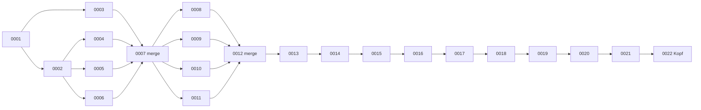

# Migrationen

> Einstieg: [[Schulmanager Architektur]] · [[Datenmodell]] · Ausführung: [[Server db]] (`migrate.upgrade_head`) beim Start durch [[Server runtime]]

Jede Schemaänderung ist eine Alembic-Revision (`schulmanager/server/migrations/versions/`). Beim Start läuft `upgrade head` automatisch (`SM_AUTO_MIGRATE=1`); mit `SM_AUTO_MIGRATE=0` meldet der Server nur, dass das Schema veraltet ist. Neue Tabellen werden in `feature_models/<name>.py` definiert und per `load_all` importiert; `test_migration_matches_models` prüft, dass Migration und Modelle übereinstimmen. Die Kette hat zwei Merge-Revisionen (0007, 0012), weil Feature-Zweige parallel entstanden. **Kopf: `0022_item_views`.**

| Nr | Revision | Vorgänger | Datum | Zweck | Neue Tabellen / Spalten |
|---|---|---|---|---|---|
| 0001 | `0001_initial` | – | 2026-10-05 | Initiales Schema: Konten, Sitzungen, Tokens, Audit, Planversionen, Mitteilungen, Schüler-Krankmeldungen, Benachrichtigungs-Outbox. | Tabellen: `users`, `sessions`, `api_tokens`, `login_attempts`, `parent_links`, `audit_log`, `school_versions`, `announcements`, `student_absences`, `notifications_outbox` |
| 0002 | `0002_files` | 0001 | 2026-10-06 | Dateiablage: Tabelle stored_files (Metadaten verschlüsselt abgelegter Dateien, Erweiterung 2 – Agent Basis). | Tabellen: `stored_files` |
| 0003 | `0003_teacher` | 0001 | 2026-10-06 | Lehrer-Selbstverwaltung: Änderungsanträge von Lehrkräften (`teacher_change_requests`). | Tabellen: `teacher_change_requests` |
| 0004 | `0004_channels` | 0002 | 2026-10-06 | Kursräume: Kanäle, Zusatzmitglieder, Ordner, Material/Aufgaben, Abgaben, Pinnwand, Besuche (Erweiterung 2, §9.4). | Tabellen: `channels`, `channel_extra_members`, `channel_folders`, `channel_items`, `assignment_submissions`, `channel_posts`, `channel_reads` |
| 0005 | `0005_messages` | 0002 | 2026-10-06 | Internes Postfach (Erweiterung 2, Agent Postfach): Unterhaltungen, Nachrichten, Meldungen, Blockierungen. | Tabellen: `conversations`, `conversation_participants`, `messages`, `message_reports`, `user_blocks`, `message_user_settings`, `message_drafts` |
| 0006 | `0006_student_self` | 0002 | 2026-10-09 | Schüler-Selbstbedienung: eingereichte Dokumente/Atteste (`student_documents`). | Tabellen: `student_documents` |
| 0007 | `0007_merge` | 0003, 0004, 0005, 0006 | 2026-10-09 | Zusammenführung der Feature-Zweige von Erweiterung 2 (Lehrer, Kursräume, Postfach, Schüler) zu einem Kopf. | – |
| 0008 | `0008_contact` | 0007 | 2026-10-10 | Kontakt & Wiederherstellung: bestätigte E-Mail/Handynummer (`user_contacts`) und Einmal-Codes (`auth_codes`). | Tabellen: `user_contacts`, `auth_codes` |
| 0009 | `0009_letters` | 0007 | 2026-10-10 | Zugangsbriefe: kurzlebige, verschlüsselte Stapel mit Startpasswörtern (`letter_batches`) und das zuletzt erzeugte Startpasswort je Konto (`account_initial_passwords`, verschlüsselt) – §11.3. | Tabellen: `letter_batches`, `account_initial_passwords` |
| 0010 | `0010_identities` | 0007 | 2026-10-10 | Verbundene Anbieter-Konten (`user_identities`) und Anbieter-Einrichtung (`sso_providers`), §11.4. | Tabellen: `user_identities`, `sso_providers` |
| 0011 | `0011_login_policy` | 0007 | 2026-10-10 | Anmelde-Richtlinien (Erweiterung 4, §11.5): Tabelle `login_policy_rules`. | Tabellen: `login_policy_rules` |
| 0012 | `0012_merge` | 0008, 0009, 0010 | 2026-10-10 | Zusammenführung der Feature-Zweige von Erweiterung 4 (Konten & Anmeldung) zu einem Kopf. | – |
| 0013 | `0013_parent_access` | 0012 | 2026-10-10 | Elternzugriff (A-44: volljährige Schüler/innen legen je Bereich fest, was Eltern sehen) und Freigabe ganzer Ordner in Kursräumen (A-46: `channel_folders.visibility` wie beim Material, zur Stunde/ab Zeitpunkt). | Tabellen: `parent_access` |
| 0014 | `0014_mail` | 0013 | 2026-10-11 | Postfach: An/CC/BCC, externe E-Mail-Adressen und verbundene E-Mail-Konten. | Tabellen: `mail_accounts`; Spalten: `conversation_participants.recipient_role`, `conversations.external`, `conversations.mail_account_id`, `messages.external_from`, `messages.external_name`, `messages.mail_message_id`, `messages.delivery` |
| 0015 | `0015_attendance` | 0014 | 2026-10-11 | Fehlzeiten: Art (krank, zu spät, früher gegangen, fehlt), Minuten, Herkunft der Meldung, wer entschuldigt hat. | Spalten: `student_absences.kind`, `student_absences.minutes`, `student_absences.source`, `student_absences.excused_by`, `student_absences.excused_by_name`, `student_absences.excused_at` |
| 0016 | `0016_grades` | 0015 | 2026-10-11 | Noten zu Klausuren und Tests (`exam_results`). | Tabellen: `exam_results` |
| 0017 | `0017_register` | 0016 | 2026-10-11 | Klassenbuch (`register_lessons`) und Verknüpfung erfasster Fehlzeiten (`student_absences.register_id`). | Tabellen: `register_lessons`; Spalten: `student_absences.register_id` |
| 0018 | `0018_support` | 0017 | 2026-10-11 | Förderinformationen je Schüler/in (Nachteilsausgleich, Schulbegleitung, Förderplan). | Tabellen: `student_support` |
| 0019 | `0019_chats` | 0018 | 2026-10-11 | Chats mit Ende-zu-Ende-Verschlüsselung (Geräte, Chats, Mitglieder, Nachrichten, Schlüssel, Meldungen). | Tabellen: `chat_devices`, `chats`, `chat_members`, `chat_messages`, `chat_message_keys`, `chat_reports` |
| 0020 | `0020_channel_material` | 0019 | 2026-10-11 | Kursräume: Unterrichtsmaterial (Datum der Stunde) und „Abgabe möglich“ auch für Material. | Spalten: `channel_items.lesson_material`, `channel_items.material_date`, `channel_items.submittable` |
| 0021 | `0021_rights` | 0020 | 2026-10-12 | Rollen & Rechte: schulspezifische Rechte-Abweichungen, Schulzweige (Abteilungsleitung). | Tabellen: `role_overrides`, `branches`, `user_branches` |
| 0022 | `0022_item_views` | 0021 | 2026-10-12 | Kursräume: welches Material ein Konto schon geöffnet hat (Hinweis „noch nicht angesehen“). | Tabellen: `channel_item_views` |
| 0023 | `0023_support_catalog` | 0022 | 2026-10-12 | Katalog der Förder-Merkmale und strukturierte Zuordnung (Minuten, Fächer, Hilfsmittel). | Tabellen: `support_catalog` |
| 0024 | `0024_chatmedia` | 0023 | 2026-10-12 | Chats: verschlüsselte Bild-/GIF-Anhänge und Bilder an Meldungen. | Tabellen: `chat_attachments`, `chat_report_images` |
| 0025 | `0025_student_prefs` | 0024 | 2026-10-12 | Elternzugriff: Zustellung von Schulinformationen und „Entscheidung getroffen“ je Schüler/in. | Tabellen: `student_prefs` |
| 0026 | `0026_exam_makeups` | 0025 | 2026-10-12 | Nachschreibtermine (exam_makeup_dates, exam_makeups) und archivierte Dokumente (withdrawn_at). | Tabellen: `exam_makeup_dates`, `exam_makeups` |
| 0027 | `0027_api_access` | 0026 | 2026-10-12 | API-Zugänge mit Umfang: Bereiche/Filter/IP/Ratenlimit an `api_tokens` und Nutzungsprotokoll `api_token_log`. | Tabellen: `api_token_log` |
| 0028 | `0028_sso_auto_signin` | 0027 | 2026-10-12 | Anmeldedienste: Schalter „automatische Anmeldung“ je Anbieter (Google One Tap, stilles Microsoft-SSO). | – |
| 0029 | `0029_class_info_cards` | 0028 | 2026-10-12 | Klassenraum: angeheftete Infokarten (Bereich „Klasse“) als Kennzeichen am Material. | – |
| 0030 | `0030_forms` | 0029 | 2026-10-12 | Formular-Baukasten: form_templates, form_versions, form_submissions, form_events. | Tabellen: `form_templates`, `form_versions`, `form_submissions`, `form_events` |
| 0031 | `0031_chat_split` | 0030 | 2026-10-12 | Trennung Postfach/Chats: Archiv, Schreibrechte, Übernahme alter Postfach-Gruppen und -Chats. | – |
| 0032 | `0032_chat_devices` | 0031 | 2026-10-12 | Chat-Geräte: Verknüpfung (Verlauf übertragen), Passwort-Backup, Geräte-Hinweise. | Tabellen: `chat_link_requests`, `chat_key_backups` |
| 0032 | `0032_self_reset_default` | 0031 | 2026-10-12 | Voreinstellung „Passwort vergessen“: Schüler/innen setzen ihr Passwort nicht selbst zurück. | – |
| 0033 | `0033_absence_log` | 0032, 0032 | 2026-10-12 | Meldungsprotokoll der Fehlzeiten (`student_absence_events`) samt Startpunkt aus den vorhandenen Daten. | Tabellen: `student_absence_events` |

## Hinweise

- Auf Tabellen mit kaskadierenden Fremdschlüsseln (`users`, `channel_folders`) kein `batch_alter_table` verwenden (SQLite würde Kindzeilen löschen); nur `add_column`.
- Migrationen sind nummeriert und benannt; Namen werden vorab in `docs/AGENT_NOTES.md` reserviert, bei zwei Köpfen entsteht eine Merge-Revision.
- Die Dokumente `docs/code/README.md` (Kopf `0013_parent_access`) und `docs/ROLLEN-RECHTE.md` (`0016_rights`) sind in diesem Punkt veraltet – tatsächlich heißt die Rechte-Migration `0021_rights`.

<!-- eigene Notizen -->
