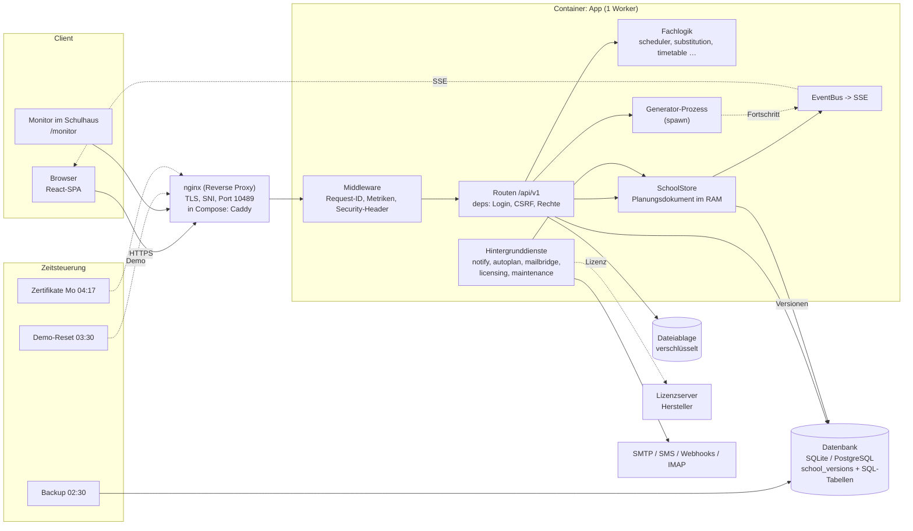

# Schulmanager Architektur

> Architektur-Dokumentation des **Schulmanagers** – Stundenplan, Vertretungsplan und Schulverwaltung für eine Schule mit ~2500 Schüler/innen, ~200 Lehrkräften und 2 Standorten. Alles hier ist vernetzt: Strg+G öffnet den Graphen, rechts oben zeigen die Rückverweise, wer auf eine Notiz verlinkt. Die Canvas-Karte: [[Schulmanager Architektur.canvas|Canvas-Übersicht]].

## Überblick

**Zweck:** automatische Stundenplan-Erzeugung aus Stundentafeln, Live-Vertretungsplanung bei Krankheit („Ausfall nur am Rand des Schultags“), dazu Schulverwaltung: Konten und Rollen, Klassenbuch, Fehlzeiten, Kursräume mit Hausaufgaben, Postfach und Ende-zu-Ende-Chats, Klausuren, Noten, Aufsichten, Monitore, Import/Export (Untis, CSV, iCal). Lizenz- und Demo-Betrieb sind eingebaut.

**Technik:** FastAPI + SQLAlchemy/Alembic (SQLite oder PostgreSQL) im Backend, React 19 + TypeScript + Vite im Frontend, ein einziger App-Prozess mit Planungsdokument im Speicher, Live-Updates per Server-Sent Events.

## Schichten

| Schicht | Ort | Notizen |
|---|---|---|
| Oberfläche | `frontend/src/` | [[Frontend Übersicht]] – [[Frontend App und Routing]], [[Frontend API-Schicht]], [[Frontend Basis]], [[Frontend Komponenten]], 26 Seiten, 15 Features |
| API | `schulmanager/server/routes/` | [[Routen Übersicht]] – 432 Endpunkte in 46 Dateien |
| Server-Kern | `schulmanager/server/*.py` | [[Server app]], [[Server runtime]], [[Server deps]], [[Server permissions]], [[Server store]], [[Server db]], [[Server events]], [[Server jobs]], [[Server files]], [[Server crypto]] … → [[Backend Übersicht]] |
| Fachlogik | `schulmanager/*.py`, `integrations/` | [[Modul models]], [[Modul scheduler]], [[Modul substitution]], [[Modul timetable]], [[Modul planning]], [[Modul weeks]] … → [[Backend Übersicht]] |
| Daten | Datenbank + Planungsdokument | [[Datenmodell]], [[Migrationen]] |
| Lizenz | `lizenzserver/` | [[Lizenzserver]], [[Server licensing]] |
| Betrieb | `Dockerfile`, `docker-compose*.yml`, `deploy/` | [[Betrieb und Deploy]] |

## Gesamtarchitektur

## Bereiche

- **Backend:** [[Backend Übersicht]] · [[Routen Übersicht]] · [[Lizenzserver]]
- **Frontend:** [[Frontend Übersicht]]
- **Daten:** [[Datenmodell]] · [[Migrationen]]
- **Querschnitt:** [[Rollen und Rechte]] · [[Abläufe]] · [[Betrieb und Deploy]] · [[Abhängigkeiten]]

## Wichtige Entwurfsentscheidungen

1. **Ein Prozess, ein Planungsdokument.** Alle Plandaten sind ein versioniertes `School`-Dokument im Speicher ([[Server store]]); Änderungen nur über `mutate` → Version, Audit, Event. Deshalb genau ein Worker.
2. **Fachlogik rein.** Generator, Vertretung, Zeitlogik arbeiten ohne DB/HTTP auf dem Dokument ([[Modul scheduler]], [[Modul substitution]]) und sind einzeln testbar.
3. **Rechte doppelt.** Recht per `require()`, Datenumfang im Router, Fremddaten → 404; das Frontend blendet nur aus ([[Rollen und Rechte]]).
4. **Datenschutz im Baustein.** Freitexte verschlüsselt (AES-GCM, [[Server crypto]]), Dateien nur über [[Server files]], Elternsicht über [[Server elternzugriff]], Chats Ende-zu-Ende ([[Feature chats]]).
5. **Autoload.** Jede `routes/*.py` und jedes `features/*/module.tsx` meldet sich selbst an – neue Bereiche brauchen keine zentrale Verdrahtung.
6. **Live per SSE.** Eine Verbindung je Tab; Scopes bestimmen, was neu geladen wird ([[Server events]]).

## Quellen im Repo

`CLAUDE.md` (Arbeitsregeln), `docs/ARCHITECTURE.md` (Verträge), `docs/code/*` (Code-Doku je Bereich), `docs/ROLLEN-RECHTE.md`, `docs/BETRIEB.md`. Diese Notizen wurden am Code geprüft (Importe, Routen, Tabellen per AST/Grep ausgelesen), Abweichungen zur Repo-Doku stehen unter „Auffälligkeiten“ in [[Abhängigkeiten]].

## Zahlen

- Backend: 145 Python-Dateien (55187 Zeilen) · 436 Routen · 63 Tabellen + 2 im Lizenzserver · 22 Migrationen · 66 Testdateien
- Frontend: 262 TS/TSX-Dateien (56556 Zeilen)

<!-- eigene Notizen -->
